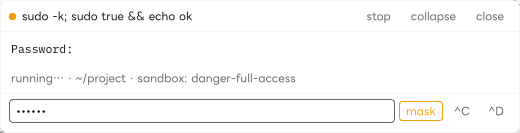

# dsh-run-button

<p align="center">
  <a href="README.md">English</a> · <a href="README.ja.md">日本語</a> · <b>中文</b>
</p>

**给 DSH 回答里的每个命令行代码块加一个 Run 按钮。** 点一下，命令就在你的机器上运行，位置是当前会话的工作区和沙箱。输出实时流进右下角的小浮窗；遇到 `yes/no` 确认或 `sudo` 密码，也能直接在 DSH 里回答。

<p align="center">
  
</p>

> 已在 DSH `0.2.1-rc.1`（macOS）上验证：运行与停止命令，回答 `read -p` / `sudo` / `ssh` 主机密钥确认，Dock 与 Panel 两种输出。

## 安装

用 `dsh` 命令行直接从 GitHub 安装这个 fork：

```bash
dsh plugin --profile web add github:lifwsp/dsh-run-button
```

卸载：`dsh plugin --profile web remove dsh-run-button`。安装或更新后请重启 DSH。

> 插件市场和 npm 上的 `dsh-run-button` 是 EdwardXiao-bit 的原版 0.1.0，不包含这个 fork 的改动（输入框、Run→AI、Panel 打开位置、DSH 0.2 支持）。

## 使用

1. 让 Agent 给出命令，或者自己写一个 `bash` / `powershell` 代码块。
2. 点代码块标题栏里的 **▶ Run**。改点 **▶ Run→AI** 的话，命令结束后 Agent 会读取结果并回复。
3. 输出出现在右下角的**浮窗**里。运行中可以停止，也可以折叠输出或关闭卡片。
4. 命令等待输入时，在输出下方的输入框里输入，按 **Enter** 发送。
   - 提示像是在要密码时（`Password:`、`パスワード:`、`passphrase` 等），输入框会自动隐藏输入内容；**mask** 可以手动切换。
   - **^C** 向程序发送 Ctrl-C，但不结束这次运行；**^D** 发送输入结束（EOF）。
5. 点 Run 旁边的 **cwd**，可以为这个代码块换一个工作目录。

消息框上方的运行条显示正在运行的命令和最近结束的一条；更早的运行收在 **+N** 里（含 **Clear finished**）。没有命令在运行时，运行条会变淡。右侧的图标用来选择输出位置，鼠标悬停可以看到名称。

| 模式 | 输出位置 | 依赖 |
| --- | --- | --- |
| **Dock**（默认） | 右下角的浮动卡片，每次运行一张 | 无 |
| **Panel** | 右侧边栏或底部工作台的标签页，每次运行一个 | [`dsh-better-sidebar`](https://github.com/omdsh-dev/DSH-better-sidebar) |
| **Off** | 不显示输出；Run 按钮仍会显示状态 | 无 |

## 支持的代码块

| 语言标记 | 按钮 |
| --- | --- |
| `bash`, `sh`, `zsh`, `shell`, `shellscript` | `▶ Run` |
| `console` | `▶ console` |
| `powershell`, `pwsh`, `ps1` | `▶ PowerShell` |
| `cmd`, `bat`, `batch`, `dos` | `▶ cmd` |

其他语言（`js`、`python` 等）不加按钮。

## 安全

- 一次运行能做的事，不会超过同一会话里的 Agent：它使用会话的**沙箱策略**和**工作区**。
- 命令严格按代码块里写的内容执行，不会拼接模型输出。
- 你输入的内容**不会被记录或保存**：不进插件日志、浏览器存储，也不进 Run→AI 的结果。密码提示会关闭终端回显，所以密码不会出现在输出里。
- 插件停止或更新时会结束正在运行的命令，刷新页面后不会留下孤儿进程。

## 限制

- **只有 `danger-full-access` 会话才能回答 `sudo` 和 `ssh` 的提示。** 在 `read-only` 和 `workspace-write` 下，macOS 沙箱不允许它们读取终端，输入框会给出说明。读取普通输入的提示（`read -p`、安装程序）在所有模式下都能回答。
- 回答提示需要 macOS 或 Linux 上的 DSH 0.2。其他环境下命令照常运行，但没有输入框。
- 输出是纯文本：颜色会被去掉，`vim`、`less`、`top` 这类全屏程序无法使用。
- 运行结束后输出保留 10 分钟，刷新页面后仍可查看，但 DSH 重启后会丢失。每条输出流上限 256 KB（可输入的运行为 1 MB）。可输入的运行 30 分钟后会自动停止。

## 开发

工作原理、测试和宿主 API 注意事项见 [docs/DEVELOPMENT.md](docs/DEVELOPMENT.md)（英文）。

## 许可证

MIT，见 [LICENSE](LICENSE)。原插件由 [EdwardXiao-bit](https://github.com/EdwardXiao-bit/dsh-run-button) 创建；这个 fork 增加了 DSH 0.2 支持、Run→AI、Panel 打开位置选择和交互式输入。
